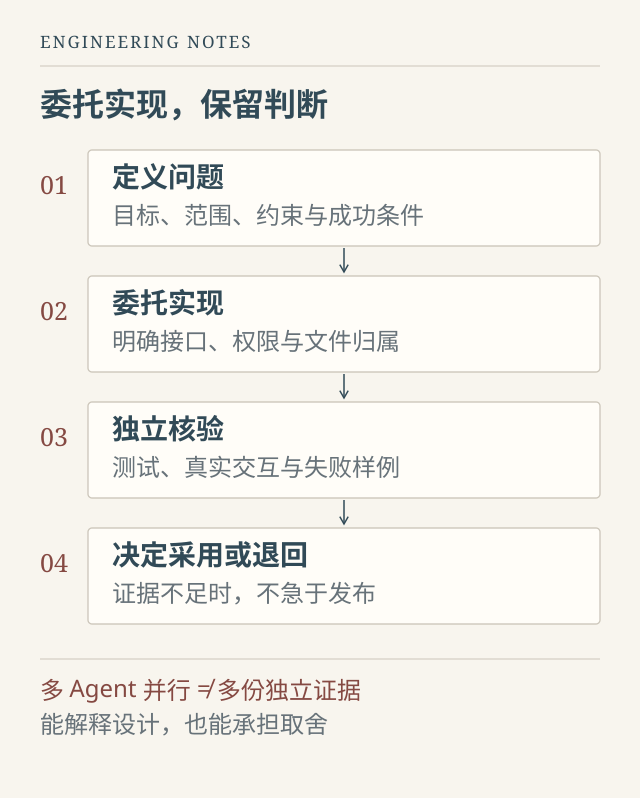

当一部分代码由 AI 生成，工程师究竟应当对什么负责？

这个问题容易走向两个极端。一种看法把手写代码量当成贡献的唯一尺度；另一种则认为，只要会描述需求、调度几个 Agent，就可以不再理解实现。实际工作让我觉得，两者都没有抓住关键。

AI 降低了产生代码的成本，却没有自动降低理解错误需求、接受错误结果的代价。代码越容易生成，人越需要判断：问题有没有定义清楚，实现是否改变了原有约束，证据够不够支持发布，以及失败之后能否退回来。

这里说的“监督员”，不是站在技术之外发指令的人，而是仍然理解实现、能够追问证据，并对最终交付负责的工程师。

## 先把问题说清楚，再让实现变快

“帮我优化这个项目”很容易得到一大批改动，却很难得到一个可验收的结果。因为性能、可读性、交互体验和科学质量，可能对应完全不同的目标，甚至彼此冲突。

比较有效的任务描述，应当交代当前发生了什么，希望改变哪个行为，以及什么不能改变。例如，用户点击取消后任务仍占用资源，要解决的是任务生命周期，而不只是让按钮更快恢复；检索已经命中文档但回答漏掉条件，要检查的是证据使用，而不一定要重新训练模型。

我会先尝试给出一个可观察的成功条件，再限制本轮范围。哪些文件允许修改，已有接口是否保持兼容，哪些结论尚未确认，完成之后应提供什么证据。这些信息不需要写成冗长的模板，但不能留给 Agent 自行猜测。

稳定规则与本次任务也应分开。仓库中的工作契约负责说明安全边界、运行方式和验证要求；临时任务则提供最新现象、相关文件和本轮验收条件。一个已经过时的长提示，不会因为写得全面就比几条准确事实更有用。

## 委托实现，不等于委托全部判断

AI 可以帮助读代码、定位异常、提出方案、补测试，也可以承担大量重复实现。但接受它的方案之前，人仍需要判断假设是否成立。

例如，增加缓存之前，要弄清什么决定了结果；把慢任务放入后台之前，要考虑取消和重启后的状态；增加自动回退之前，要确认回退不会悄悄改变结果含义。这些问题不要求工程师比模型更快地写出样板代码，却要求能读懂关键路径，必要时能够独立修改和排查。

*图 1：协作职责示意。实现可以大量委托，验收依据与发布决定仍需要明确的责任主体。*

“这段代码不是我手写的”并不妨碍一个人解释设计、修复缺陷、承担责任；反过来，手工输入了全部代码，也不自动说明理解了系统。更有说服力的贡献，是能够说明为什么这样分层、排除了哪些方案、如何找到问题，以及哪些边界仍然没有验证。

这也要求如实区分个人、AI 与协作者的工作。能够组织交付是一种能力，但不应把别人的研究、模型或模块归为自己的独立成果。

## 多 Agent 的价值，取决于任务边界

多 Agent 协作并不是把同一个模糊目标复制给更多模型。几个 Agent 同时修改同一组核心文件，往往会带来冲突、接口漂移和重复工作。

更适合并行的是边界明确的任务：一个检查调用链，一个整理失败样例，一个验证某条接口的回归行为。实现任务也可以并行，但需要先约定接口、文件归属和集成方式，并指定一个最终整合者。

审查者最好获得独立的验收依据，而不是只阅读实现者对自己工作的总结。否则，“已修复”“已测试”很容易在多个 Agent 之间被反复转述，最后看起来像经过多方确认，实际上仍然只有一份未经核对的声明。

并行之前还需要估计整合成本。一个很小的改动，单个 Agent 沿着明确路径完成，可能比调度、同步和解决冲突更加可靠。多 Agent 是组织手段，不是质量证明。

## 把“完成了”拆成能够核对的证据

我现在会有意识地区分几种状态：Agent 声称完成，代码发生了变化，针对性测试通过，真实交互走通，以及目标环境中的关键行为经过验证。这些状态之间有联系，却不能相互替代。

单元测试可以验证局部逻辑，但未必覆盖外部依赖和浏览器行为；一次页面演示可以证明流程可达，却未必覆盖取消、异常与并发。对于模型系统，还要分开检查程序能否运行、输出是否符合契约，以及内容或科学结果是否正确。

测试也可能写错。如果实现和测试同时依据同一个误解生成，二者会相互“证明”。因此，一部分验收条件应直接来自用户需求、原始数据或既有接口契约；异常分数和意外通过，都值得回到具体样例核查。

一份好的交付说明，应说清改了什么、验证了什么、没有验证什么。不要把“目前没有发现错误”表达成“不可能出错”，也不要把本地通过写成已经具备生产可用性。

## 安全边界，应当在执行之前建立

能读文件、执行命令、访问网络的 Agent，不只是一个写作助手。它接触到的网页、依赖说明和日志，都可能含有不可信内容。这些内容可以作为分析材料，却不能自动获得修改任务目标或扩大权限的资格。

实际协作时，权限应与任务相匹配。只需排查问题，就先保持只读；需要修改代码，就限制在相关仓库；涉及删除、远程发布、凭据或生产环境，必须有明确授权和相应验证。密码、密钥和私人资料也不应为了“给足上下文”而进入提示词、日志或公开提交。

提交与发布同样需要分开。可以先在本地保留可追溯的改动，再检查差异与待推送历史，最后进入远程仓库。只检查最新文件而不检查历史，可能遗漏已经进入旧提交的敏感内容。自动化应该减少重复操作，而不是取消这些边界。

## 最重要的判断，有时是不采用

在一次 RAG 迭代中，新模型的训练损失下降，部分开发集表现也有所改善，但独立评测没有支持它替代原有版本。最后保留了旧模型，采用经过验证的工程改进。

这个决定对我很有启发。项目进展不一定体现为“又升级了一个版本”，也可以体现为排除了一个缺乏依据的选择。保留实验结果、记录没有采用的原因，同样是在积累知识。

事先约定采用条件，会比结果出来之后再解释更可靠：哪些质量不能退步，哪些成本可以接受，什么证据不足时应该继续观察。条件应当服务于实际任务，而不是为了凑齐一套看起来完整的指标。

AI 协作最终改变的，是劳动的分配，而不是责任的消失。工程师可以少做重复输入，但仍要理解问题、控制边界、核查证据，并承担取舍。真正值得追求的，不是让 Agent 一直工作，而是让每一轮工作都留下可信、可维护、可继续推进的结果。
