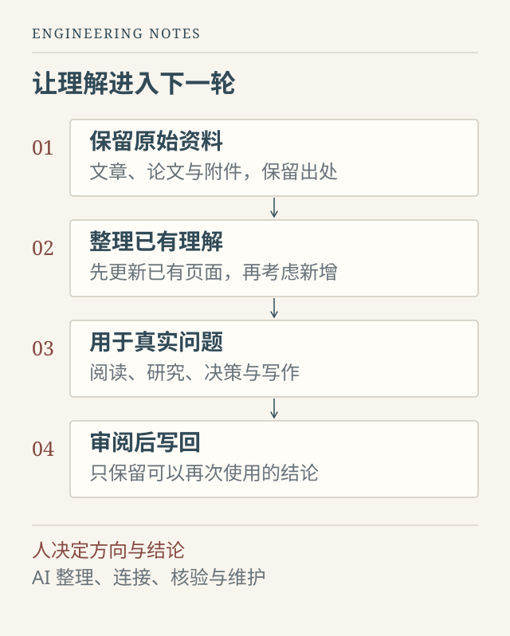

真正让我开始整理知识库的，不是资料不够多，而是资料已经很多，却仍然经常需要从头找起。

一篇文章收藏过，一段代码研究过，一个问题也曾与 AI 反复讨论。过了一段时间，只记得自己“应该知道”，却说不清结论来自哪里、适用什么条件，更无法判断当时的理解是否已经过时。资料仍在，理解却没有可靠地留下来。

我之前写过 Karpathy 的 LLM Wiki 思想。这一次，更想谈谈把它放进自己的日常工作之后，究竟应当保留什么，又应当删去哪些不必要的复杂度。

## 知识库的对象，不是文件，而是可以继续使用的理解

Karpathy 提出的关键变化，是在原始资料与临时回答之间，维护一层持续更新、相互链接的 Wiki。新材料进入后，不只是等待下一次检索，而是参与修订已有认识。这是一种知识工作方式，并不意味着必须采用某个固定产品。[原始说明：LLM Wiki](https://gist.github.com/karpathy/442a6bf555914893e9891c11519de94f)

这给我的启发是：不要再以“整理了多少篇”衡量进展。

例如，读完一篇关于 RAG 的文章，保存全文很容易，生成一份摘要也不难。但下一次项目出现“文档搜到了，答案还是不对”的问题时，我真正需要的是：有哪些可能原因，如何把问题定位到检索、证据组织或生成阶段，哪些判断已经有实验支持。能够参与下一次判断的内容，才值得进入长期知识页。

原文、摘要和知识页可以同时存在，但职责不同。原文供追溯，摘要帮助快速了解内容，知识页负责把多次阅读和实际工作连接起来。如果三者只是换个格式重复同一段话，文件数量增加了，使用成本也一起增加了。

## 让日常入口变少，让后台工作更可靠

我的这套系统用 Markdown 保存内容，用 Obsidian 阅读和浏览，再让 AI 参与整理与维护。最需要约束的不是模型能力，而是系统不断长出新目录、新表格和新流程的冲动。

因此，日常只保留一个首页。零散资料可以先放入 Inbox，不要求自己在输入时就完成精确分类。原始来源、图片附件和系统模板留在后台，阅读时主要接触知识页与正在推进的项目。已经存在的主题，优先补充已有页面，而不是每问一次就生成一篇新笔记。

*图 1：这套知识库的工作示意。AI 负责维护过程，人负责重要判断；只有可复用的结果才进入下一轮。*

这并不要求目录越少越好，而是要求每一个结构都有明确用途。原始论文与自己的结论应当分开，阶段实验与当前决策也应当分开；但没有必要为同一份内容同时维护目录页、阅读清单、进度表和操作日志。如果一项字段既不影响检索，也不影响判断和发布，就不值得让人反复填写。

Obsidian 在这里首先是阅读和写作界面。链接、搜索和目录已经能承担相当一部分工作。插件是否加入，取决于它解决了哪个反复出现的问题，而不是它能否让知识库看起来更像一个复杂系统。

## 把“现在是什么”与“为什么走到这里”分开

项目内容积累之后，最容易出现的混乱不是没有记录，而是多个时期的记录都像最新结论。

一个模型早期效果不错，后来换了评测口径；一个功能曾经只是演示，后来才接入真实后端；某次实验虽然没有采用，却解释了为什么最终选择另一条路线。如果把这些内容摊在同一个层次，AI 很容易引用到旧数字，人也容易把计划当成事实。

我现在更倾向于区分三种材料：当前状态说明“现在采用什么、哪些尚未完成”；阶段记录解释“当时尝试了什么、为什么接受或放弃”；原始报告和日志则回答“凭什么这样说”。

这不是要求每个项目新建三个文件。简单项目可能一页就够，内容较多时才需要拆开。重要的是阅读顺序：先看当前状态，再按需回溯决策，最后核对证据。旧材料不必删除，但必须让读者知道它属于哪个阶段。

对 AI 也是一样。把全部历史塞进上下文，并不等于提供了更好的帮助。一段明确的当前状态，加上必要的证据入口，往往比混合了多个版本的长篇记录更容易使用。

## AI 可以写回知识，不能替我决定相信什么

AI 最适合承担那些重要却容易被拖延的工作：清理导出格式、保存附件、补充来源、寻找相关页面、提示新旧内容之间的冲突。它可以提出综合判断，但不能把推测悄悄改写成事实。

比如，我说“这个方向值得尝试”，它不应写成“已经验证有效”；一次脚本成功运行，也不能自动升级成“系统已经具备生产可用性”。同样，一篇论文提出的结论，进入知识库之后仍然是论文的结论，不会因为被整理成了漂亮的页面就变成已确认的共识。

我希望一个后来接手项目的 AI，能够分辨用户的判断、文献的主张、实际运行的证据，以及仍然需要验证的推断。这也是为什么仓库需要一份简洁的工作契约：保护原件，先搜索再新增，保留不确定性，重要结论能够回到来源。

对话结束后也不必全部归档。真正值得写回的，通常是一个经过澄清的概念、一项有依据的决策、一种可以再次使用的排查方法。临时表达、重复解释和没有证据的猜测，可以留在对话里。知识库不是聊天记录的另一种存储格式。

## 同步与发表，是两件不同的事

Git 很适合保存文本修改历史，但“已经提交”“已经推送”和“已经公开发表”不是同一个状态。

知识页是否允许进入网站，应当由独立的发布条件控制。我在 Wiki 中保留文章类型、审阅状态和发布开关，只有满足条件的内容才导出到网站，并转换内部链接、附件路径和网站所需的元信息。发布前，还要实际检查封面、正文图片与移动端排版。

这里有一条容易忽视的边界：`publish: false` 只能阻止文章进入网站，不能保护已经上传到公开 Git 仓库的文件。真正的隐私取决于仓库权限、提交内容和提交历史。文件从最新版本中删除，也不代表历史中已经不存在。备份策略与公开策略，应当分别设计。

因此，知识库可以包含尚在整理的想法，而博客应该是一份面向读者重新组织过的表达。前者保留工作现场，后者交代背景、问题、判断与限制。公开文章不需要把内部目录、实验草稿和个人信息一起搬出去。

## 最后，系统应该让人更轻松

我希望长期得到的，不是一个越来越壮观的文件仓库，而是一种更稳定的工作习惯：遇到问题时先查看已有理解，发现变化时修订它，做出判断时留下依据，写文章时从这些积累出发。

这套方式也不会让模型真的“学会”我的全部知识。Markdown 是可读取的外部记忆，不是模型权重；AI 仍然可能遗漏、误解或引用过时内容。它的价值，在于让这些错误更容易被发现，让下一次协作不必从零开始。

如果过了一段时间，找资料更快了，重复解释变少了，旧结论也更容易被修正，这个知识库就已经发挥了作用。至于它有多少插件、多少节点、多少篇笔记，反而不是最重要的事。
