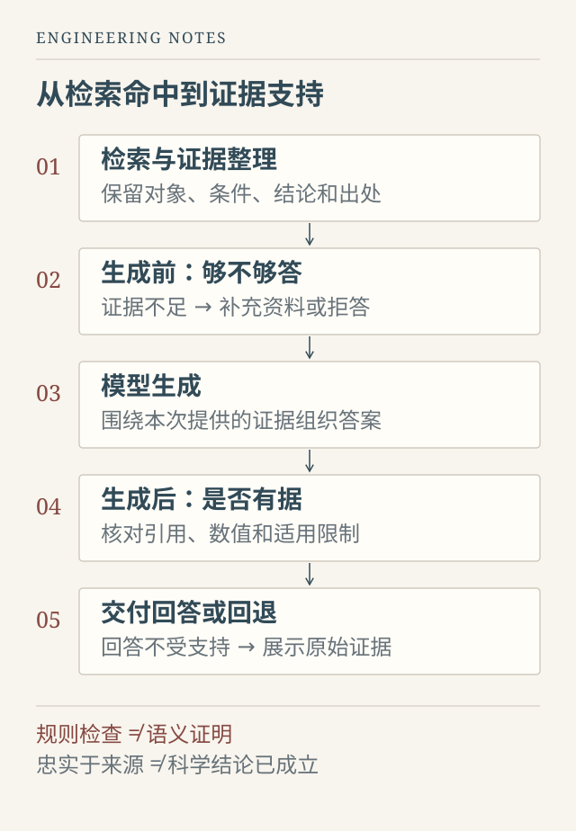

做论文问答时，一个很容易让人困惑的现象是：正确的文档已经出现在检索结果中，模型却仍然漏掉关键条件，或者给出一个听起来合理、实际并没有被原文支持的答案。

遇到这种情况，直觉上的做法往往是换更强的模型、继续微调，或者检索更多内容。但在我参与的科研问答原型中，把链路拆开检查之后，问题并不总是出在模型参数上。有时，答案需要的事实已经找到了，只是没有被妥当地交给模型；有时，系统其实还没有足够证据，却已经开始组织答案。

这篇文章复盘的是当时的工程判断，而不是当前产品的能力声明。为避免混淆不同版本的实验口径，下面不引用内部性能数字，重点讨论可以迁移到其他 RAG 系统的方法。

## “检索命中”不是一个完整的成功条件

RAG 将检索到的外部信息与生成模型结合起来，为知识密集型任务提供依据。这是一个有用的基本框架，但它不会自动保证最终回答忠实于证据。[Lewis 等，Retrieval-Augmented Generation for Knowledge-Intensive NLP Tasks](https://arxiv.org/abs/2005.11401)

从工程上看，“找到了”至少有三种含义：找到了正确文档，找到了与问题相关的片段，以及最终送入模型的上下文确实包含回答所需的事实。这三件事并不等价。

一篇论文可能同时讨论多个样品、不同温度和不同实验条件。搜索结果命中论文标题，不能说明所选片段包含目标样品的结论；片段中出现目标数值，也不能说明数值对应的单位、对象和条件都被保留下来了。

因此，我在排查时把两个问题分开看：期望事实是否进入最终证据，以及这些事实是否被答案正确表达。前者失败，优先检查文档解析、检索和裁剪；前者成功、后者失败，再检查生成、提示组织和答案校验。这个分层不能单独证明根因，却能显著缩小排查范围。

*图 1：工程设计示意。生成前检查关注证据是否足够，生成后检查关注回答是否受到支持；两者都不是科学正确性的证明。*

## 证据更短，未必意味着证据更好

早期方案直接把较长的文档片段交给模型。这样容易保留较多事实，也会同时带入背景介绍、重复叙述和无关内容。后来尝试先检索片段，再选取相关句子，并保留来源信息，让模型面对更集中的证据。

这一步确实改变了回答的组织方式，但很快遇到另一种问题：裁剪过于积极，必要条件也被一起删除了。

假设一份材料写道：“样品 A 在条件 X 下得到结果 Y。该结果不适用于条件 Z。”这只是一个说明机制的假设例子。如果只选出第一句，答案可能看起来更简洁，却丢失了适用边界；如果只提取数值 Y，甚至连它属于哪个样品都无法确定。

所以，句子级证据整理不能简单理解成“选最相似的几句话”。它应当保留足够的邻接上下文，尽量把实体、条件、数值和限制放在同一个可核对的单元里。预算不够时，也需要知道自己删去了什么，而不是只看提示词缩短了多少。

《Lost in the Middle》在其研究任务与模型中观察到，相关信息在上下文中的位置会影响模型表现。这提醒我们：能接收长上下文，不等于能稳定使用其中的全部信息。但这不是“短上下文永远更好”的证据，更不能直接套用到所有新模型。[Liu 等，Lost in the Middle](https://arxiv.org/abs/2307.03172)

实际选择仍然要回到自己的任务：保留了哪些事实，丢失了哪些条件，模型能否正确使用。最短的上下文与最可靠的上下文，往往不是同一个。

## 先判断有没有资格回答，再判断回答是否可信

科研问题对条件十分敏感。用户问的是某种压力下的性质，证据只说明常压情况；用户问实验测量值，文档给出的却是模拟结果。这些内容可能高度相似，却不能互相替代。

因此，需要在生成之前检查证据是否覆盖问题要求的对象和条件。证据不足时，可以明确说明缺少哪一部分，或者询问用户是否接受缩小问题范围。单一的向量相似度并不能承担这个判断：它衡量的是一种表示空间中的接近程度，不是“足以支持答案”的通用概率。

生成之后，则要检查另一件事：模型是否使用了本次提供的来源，回答中的数值是否有对应依据，有没有把原文的限定结论扩展成普遍结论。引用编号存在，只能说明引用形式可能有效，不能证明引用真的支持这句话。

我们当时采用了引用、数字、重复内容等轻量检查。这类规则便宜、可解释，也方便加入回归测试，但局限同样明确：相同数字可能属于另一个样品，词语重合也可能表达相反意思。更严格的系统还需要逐项核对“对象—条件—结论”，并对高风险内容安排人工复核。

对于无法确认的回答，回退到带来源的原始证据，通常比继续润色一个不可靠的结论更合适。不过，回退不是另一种“正确答案保证”：它只是降低了额外生成造成的风险，原文质量与解释责任仍然存在。

## 评测器也会犯错

这轮工作中，还有一个比调模型更有提醒意义的小问题：自动评测曾把“不必为每个任务从头训练”判成了“每个任务从头训练”。原因是规则只检查某个子串是否出现，没有处理否定关系。

如果只看最终分数，这会被理解成模型犯了明显的知识错误；回到样例，才发现错误发生在评测器。

因此，指标也需要自己的测试。否定表达、单位换算、同义说法、部分回答和错误归因，都是值得单独检查的边界。给规则补几个否定词，可以修复一个已知错误，却不能由此声称已经具备完整语义理解。

我更愿意把评测结果理解为通往失败样例的索引。聚合分数用来观察趋势，具体样例帮助解释变化。样例应该进一步分成证据没有找到、证据在裁剪中丢失、模型漏答、模型错答，以及门控误判等类型。不同错误需要不同修复，而不是统一归入“模型不够强”。

## 不是每一次训练，都应该成为一次上线

后续尝试过新的模型版本。训练损失和开发集上的部分表现有所改善，但在预先固定的留出评测中，并没有形成足够稳定的优势。最后保留了原来的模型版本，采用经过验证的证据整理和检查模块。

这不是说微调没有价值，而是说需要证明：新增训练解决了哪个已定位的问题，改善是否超出样本波动，代价是否值得。一次版本号更新，不应替代一次选型判断。

固定评测集也有边界。反复查看它并据此调参，最终会让它逐渐变成开发集。随着系统迭代，应当补充新的独立测试、真实失败案例和人工抽查，不能把某一次通过长期当作有效证明。

对我来说，这次复盘最重要的收获，是把“让模型回答得更好”改写成了一组可以检查的问题：资料解析是否可靠，关键证据是否保留，问题是否可回答，答案是否越过证据边界，失败时是否能够安全退回。

一个可信的科研问答系统，不仅要知道如何回答，也要能说明依据在哪里、限制是什么，以及什么时候还不能回答。
