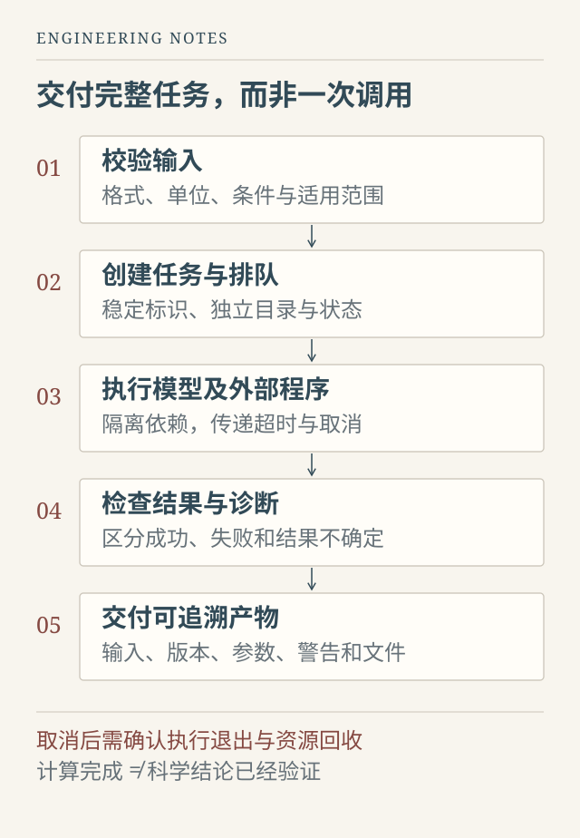

在 Notebook 中完成一次推理，与让另一个人稳定地使用这个模型，中间隔着一整套工程问题。

开发者通常知道输入应该长什么样，了解当前模型版本，也知道哪些报错可以忽略。真正的用户却未必知道文件单位是否正确，任务为什么没有进展，页面上的候选结果是否经过验证，以及关闭网页之后计算还会不会继续。

在参与衍射分析相关软件的过程中，我逐渐把注意力从“模型能不能跑”移向“一个任务能不能被完整地交付”。下面讨论的是从这些工作中提炼出的通用设计原则，不涉及内部数据和性能指标，也不代表每一项机制都已在所有系统中实现。

## 用户提交的是一个问题，不只是一个文件

以粉末衍射分析为例，用户上传一条谱线，希望得到的通常不是一个孤立的预测标签，而是对候选结构的判断，以及能够继续核查和分析的结果。

这意味着，输入契约不能止于“接受 CSV”。系统还需要知道各列含义、横轴单位、必要的实验条件，以及缺失信息将如何影响后续计算。能被程序读入的文件，不一定适合交给模型；能够完成推理的输入，也未必处于模型有证据支持的适用范围内。

这些检查最好尽量前置。空文件、非法数值、缺少关键字段，可以在排队前就说明。涉及专业判断的情况，则应保留警告与用户确认，不能用自动补默认值掩盖不确定性。

输出同样需要契约。候选排序、拟合曲线、诊断日志与可下载文件分别回答不同问题。候选排名靠前，只能表示它在当前模型和筛选条件下更值得检查，不应直接写成已经确认的真实结构。计算完成与科学结论成立，必须分开表达。

## 围绕任务组织系统，而不是围绕按钮拼接脚本

界面很容易自然地长成“预处理按钮”“预测按钮”“精修按钮”。如果每个按钮都单独调用一套流程，很快就会出现参数不一致、重复计算，以及同一个结果在不同入口表现不同的问题。

我更倾向于让界面描述用户意图，让领域流程组织实际步骤，再由独立的执行层调用模型和外部程序。交互入口可以不同，底层的输入检查、参数解释与结果结构应尽量一致。

*图 1：任务生命周期的设计示意。失败、取消与结果不确定都应有明确状态，不能仅以页面是否显示报错区分。*

一个任务应有稳定标识，并记录输入、参数和执行状态。用户看到“运行中”时，应能知道它是在等待资源、执行模型，还是等待外部精修程序。系统失败之后，也应该保留足够的信息，帮助判断是输入问题、依赖问题、超时，还是输出本身不满足要求。

这种设计不必一开始就引入复杂的分布式队列。单机服务同样可以先把任务目录、状态转换和结构化结果做好。基础边界清楚之后，再根据真实并发量决定是否增加独立工作进程和调度组件。

## 最难处理的，往往是模型之外的程序

科研工作流经常依赖既有科学软件。它们可能要求特定解释器、复杂依赖或独立运行环境。以需要隔离运行的精修引擎为例，把外部程序放到独立进程中，常常比让它与 Web 服务共享全部依赖更容易管理。但这是一种针对环境和风险的选择，并不是所有科学软件都必须采用相同方式。

隔离之后，新的问题是生命周期：谁启动它，最长运行多久，失败如何报告，取消时谁负责停止，退出之后哪些文件应当保留。

Python 的不同调用方式也有重要差别：`subprocess.run(..., timeout=...)` 超时后会终止并等待其直接子进程；直接调用 `Popen.communicate(timeout=...)` 则不会在超时后自动终止进程，需要调用者处理。官方文档还提醒，使用管道时不能只等待退出而不消费输出，否则可能因缓冲区填满而阻塞。[Python subprocess 文档](https://docs.python.org/3.13/library/subprocess.html)

这说明“加了一个 timeout”还不够。超时必须到达实际执行层，并且触发正确的终止和回收。如果程序继续创建子进程，还要针对操作系统处理进程组或作业对象；停止直接子进程，不一定能清理整棵进程树。

取消也是如此。页面上停止等待，不代表计算已经停止。合理的取消过程，应把取消请求传递给任务执行层，在确认计算退出和资源回收后，再进入终止状态。做不到立即取消时，就应当明确显示“正在取消”或“当前阶段不可中断”，而不是先告诉用户已经完成取消。

## 缓存不是偷偷跳过计算

科研任务往往很耗时。缓存能够减少重复工作，但如果缓存键只使用文件名，同名文件内容改变后仍可能返回旧结果；如果模型或预处理方式已经更新，旧缓存也未必继续适用。

因此，复用条件应当覆盖真正影响结果的因素，例如输入内容、关键实验条件、预处理与模型版本、运行参数。哪些因素进入键，需要根据实际流程决定，不能照抄一份通用字段表。

缓存命中还应对用户可见：这次结果来自哪次计算，沿用了哪些配置，是否可以强制重新运行。否则，用户以为自己正在验证新参数，系统却在返回旧产物，会比单纯的运行失败更难发现。

类似地，快速模式和完整模式应描述清楚计算预算与流程差异。减少候选数、跳过精修和使用近似方法，是不同的工程选择，不能都笼统地归为“加速”。如果一种模式改变了结果可解释的范围，就应当随结果一起说明。

## 完成一次计算，还要能够解释这次计算

一个可交付的结果，除了图和数值，还需要能够回答几个朴素问题：使用了哪份输入，采用了什么版本，哪些步骤成功了，哪些步骤跳过了，有没有警告，如何复现。

这不意味着把所有日志直接展示给用户。界面可以先给出简洁的结论和限制，再提供参数、诊断与原始产物的入口。后台细节可以复杂，前台表达应该清楚。

验收时也不能只点击一遍正常流程。错误格式、空结果、外部进程超时、重复提交、服务重启和取消请求，都可能改变任务状态。哪些情况已验证，哪些仍未覆盖，应当如实记录。一次演示成功，可以证明某条路径可运行，却不能证明长期稳定，更不能替代科学有效性的独立评估。

我现在理解的科研软件工程，是把模型能力放进一个有边界、可追溯、可以恢复的过程里。模型回答的是“能算出什么”，软件还要回答“这一次究竟算了什么，为什么值得相信，出问题后怎么办”。

这些工作未必最显眼，却决定了一个研究原型能否真正被别人使用。
